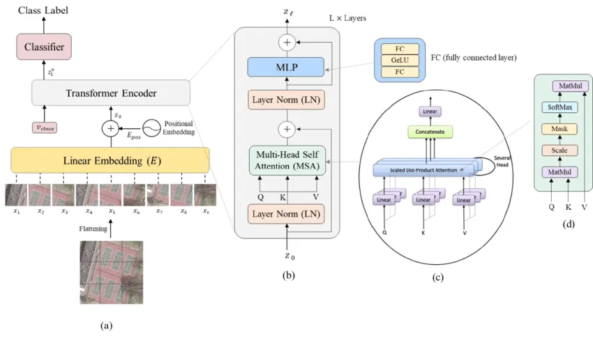
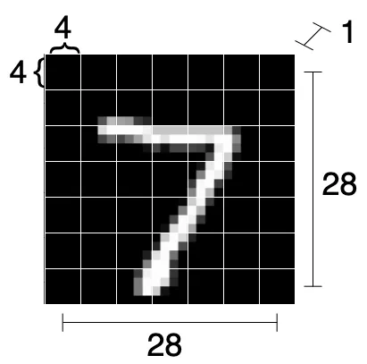
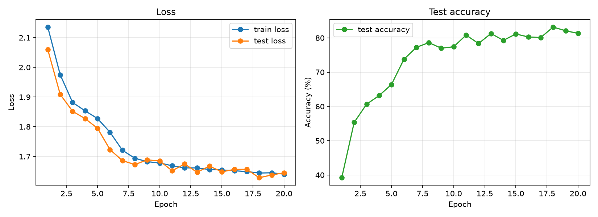
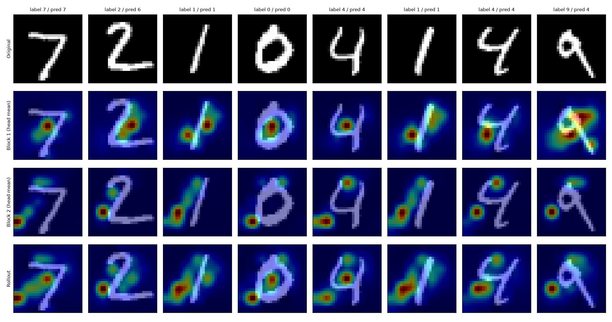

# ViT from Scratch

Building a Vision Transformer (ViT) step by step with PyTorch, trained on MNIST.

The whole walkthrough lives in [transformer.ipynb](transformer.ipynb). Each component is added incrementally, with a shape check after every step, so you can see how the tensor changes as the model grows.

> **Note:** `patchify` and `MyMSA` are now vectorized over the batch (`unfold` + `permute`, and batched per-head attention), which makes training much faster (~8 s/epoch on an RTX 4060 vs. ~3.8 min/epoch with the original loops). The original loop versions are kept as comments in the notebook for reference. The model itself is still tiny, so accuracy is limited.



## Contents

- [Requirements](#requirements)
- [Quick start](#quick-start)
- [Walkthrough](#walkthrough)
- [Model configuration](#model-configuration)
- [Training setup](#training-setup)
- [Results](#results)
- [Attention visualization](#attention-visualization)
- [Project structure](#project-structure)
- [Known limitations](#known-limitations)

## Requirements

- Python 3.8+
- `torch`, `torchvision`
- `numpy`
- `tqdm`
- `matplotlib` (positional embeddings, training curves, attention heatmaps)
- Jupyter / VS Code with the Jupyter extension

```bash
pip install torch torchvision numpy tqdm matplotlib jupyter
```

A GPU is optional; the code automatically uses CUDA when available.

## Quick start

```bash
git clone <this-repo>
cd ViT_from_scratch
jupyter notebook transformer.ipynb
```

Run the cells from top to bottom. The last cell (`main()`) downloads MNIST into `datasets/`, trains for 20 epochs, evaluating on the test set after every epoch and saving the best weights to `best_vit.pt`. It then plots the training curves and the attention heatmaps.

## Walkthrough

| Step | Component | Output shape (batch of 7 MNIST images) |
|------|-----------|----------------------------------------|
| 1 | **Patchify**: split each image into `n_patches × n_patches` patches and flatten each | `(7, 49, 16)` |
| 2 | **Linear mapper**: project each flattened patch to `hidden_d` | `(7, 49, 8)` |
| 3 | **Class token**: prepend a learnable token used for classification | `(7, 50, 8)` |
| 4 | **Positional encoding**: add fixed sinusoidal embeddings | `(7, 50, 8)` |
| 5 | **Multi-head self-attention (`MyMSA`)**: per-head Q/K/V, scaled dot-product attention | `(7, 50, 8)` |
| 6 | **Transformer block (`MyViTBlock`)**: LayerNorm → MSA → residual, LayerNorm → MLP → residual | `(7, 50, 8)` |
| 7 | **Stack blocks**: `n_blocks` encoder blocks | `(7, 50, 8)` |
| 8 | **Classification head**: take the class token, apply Linear + Softmax | `(7, 10)` |

### 1. Patchify

A batch of square images `(N, C, H, W)` is turned into `(N, n_patches², H·W·C / n_patches²)`. With 28×28 MNIST images and 7×7 patches, each image becomes 49 patches of 4×4 = 16 pixels. The implementation uses `unfold` on the height and width dimensions, then `permute` + `reshape`, so no Python loops are needed.



```python
patchify(images, n_patches)
```

### 2. Linear mapper

Each flattened patch is projected to a `hidden_d`-dimensional token with `nn.Linear`.

### 3. Class token

A learnable parameter is prepended to every sequence. After the encoder, only this token is used for classification, since attention lets it gather information from all patch tokens.

### 4. Positional encoding

Sinusoidal embeddings are generated by `get_positional_embeddings(sequence_length, d)`:

```
PE(i, j) = sin(i / 10000^(j/d))        if j is even
PE(i, j) = cos(i / 10000^((j-1)/d))    if j is odd
```

They are stored with `register_buffer`, so they move with the model across devices but are not trained or saved in the state dict. Running the file directly plots them as a heatmap.

### 5. Multi-head self-attention

`MyMSA` splits each token into `n_heads` chunks. Each head has its own `q`, `k`, `v` linear layers and computes

```
softmax(Q · Kᵀ / sqrt(d_head)) · V
```

All heads are computed for the whole batch at once (`q @ k.transpose(-2, -1)`), and the head outputs are concatenated back to the original token dimension.

### 6. Transformer block

`MyViTBlock` is a pre-norm encoder block with residual connections:

```
out = x   + MSA(LayerNorm(x))
out = out + MLP(LayerNorm(out))      # Linear → GELU → Linear, ratio 4
```

### 7–8. Full model and classification head

`MyViT` ties everything together: patchify → linear mapper → class token → positional embedding → `n_blocks` × `MyViTBlock` → class token → `Linear(hidden_d, out_d)` + `Softmax`.

## Model configuration

```python
model = MyViT(
    chw=(1, 28, 28),   # channels, height, width
    n_patches=7,       # patches per side (49 total)
    n_blocks=2,        # transformer encoder blocks
    hidden_d=8,        # token dimension
    n_heads=2,         # attention heads
    out_d=10,          # number of classes
)
```

`hidden_d` must be divisible by `n_heads`, and the image height and width must be divisible by `n_patches`.

## Training setup

| Item | Value |
|------|-------|
| Dataset | MNIST (downloaded to `datasets/`) |
| Batch size | 128 |
| Optimizer | Adam, lr = 0.005 |
| Loss | `CrossEntropyLoss` |
| Epochs | 20 |
| Checkpoint | best test accuracy saved to `best_vit.pt` |
| Seeds | `np.random.seed(0)`, `torch.manual_seed(0)` |

The test set is evaluated after every epoch; the weights with the highest test accuracy are saved. Note that the test set is used for checkpoint selection, so the reported best accuracy is slightly optimistic.

## Results

Best test accuracy: **83.16%** (epoch 18); final epoch: 81.32%. Training loss goes from 2.14 to 1.64 over 20 epochs.



## Attention visualization

The last section of the notebook loads `best_vit.pt` and overlays the class token's attention on the input digits: per block (mean over heads) and as attention rollout across blocks.



## Project structure

```
ViT_from_scratch/
├── transformer.ipynb   # step-by-step implementation and training
├── images/
│   ├── vit_arch.webp   # ViT architecture diagram
│   └── pachify.webp    # patchify illustration
├── training_curves.png     # loss / accuracy curves (generated)
├── attention_heatmaps.png  # CLS attention overlays (generated)
├── best_vit.pt             # best checkpoint (generated)
├── datasets/           # MNIST data (auto-downloaded, git-ignored)
└── README.md
```

## Known limitations

- Attention still loops over heads (batched over samples); this is for learning, not production.
- The model is tiny (`hidden_d=8`), so accuracy is limited.
- The classification head applies `Softmax` and the loss is `CrossEntropyLoss`, which already applies log-softmax internally. This works, but is redundant; for a cleaner setup, remove the `Softmax` from the head.
- Only square images are supported by `patchify`.

## References

- Dosovitskiy et al., [*An Image is Worth 16x16 Words: Transformers for Image Recognition at Scale*](https://arxiv.org/abs/2010.11929)
- Vaswani et al., [*Attention Is All You Need*](https://arxiv.org/abs/1706.03762)
